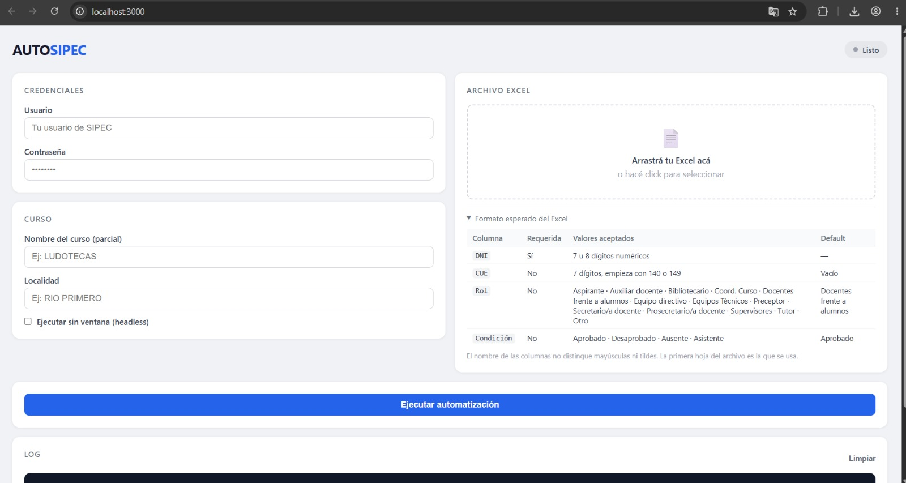
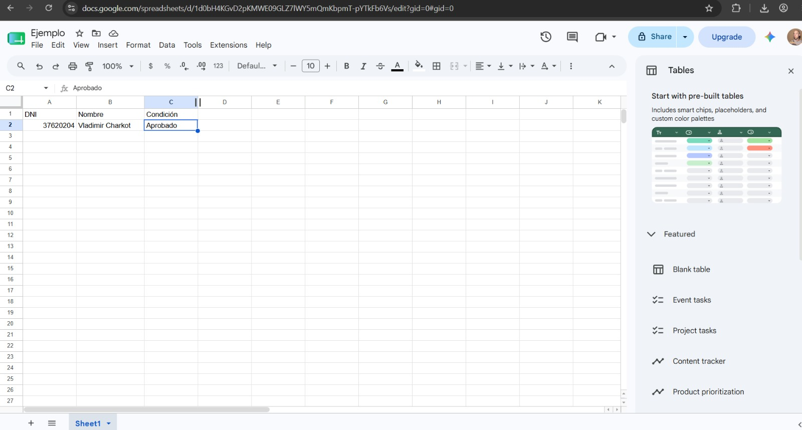
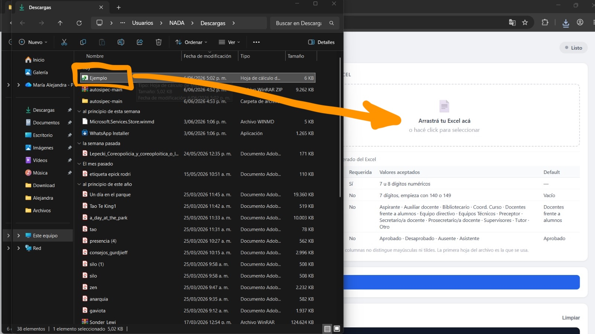
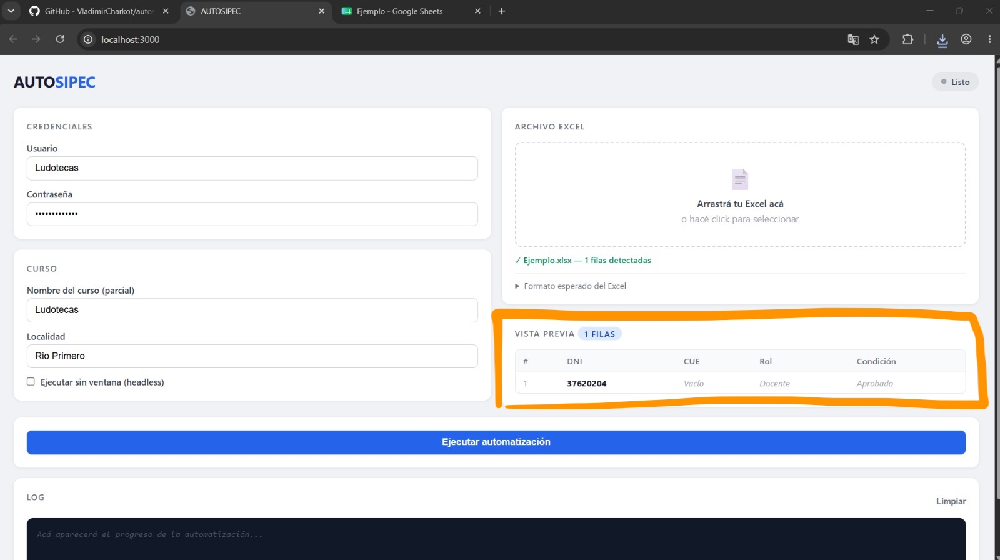
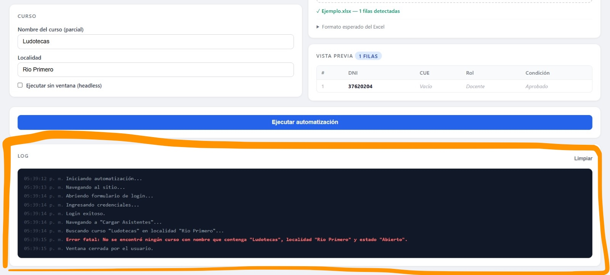

# AUTOSIPEC

Automatización de la carga de asistentes a capacitaciones en **SIPEC-CBA**.

En lugar de cargar uno por uno a los participantes de una capacitación, AUTOSIPEC toma un Excel con la lista de personas y los inscribe automáticamente. Vos solo cargás tus credenciales, el nombre del curso, la localidad y el archivo Excel. El programa **solo carga los estudiantes** y le deja al usuario la confirmación final y la posibilidad de revisar y editar los datos antes de enviar.

---

## Instalación

Descargá el instalador correspondiente desde [la página de lanzamientos](https://github.com/VladimirCharkot/autosipec/releases/). 

Si windows te muestra un mensaje como "Windows protegió su PC", clickeá "Más información" y ejecutalo de todas formas. 

La primera vez que lo ejecutes se va a descargar el navegador Chromium automatizable por vez única. 

---

## Cómo usar AUTOSIPEC

### 1. Abrir la interfaz

Ejecutá el instalador y abrí la aplicación.

### 2. Completar los datos

En el panel de la izquierda, completá:

- **Usuario** y **Contraseña**: tus credenciales de SIPEC.
- **Nombre del curso (parcial)**: alcanza con una parte del nombre (ej: `LUDOTECAS`).
- **Localidad**: la localidad de la capacitación (ej: `RIO PRIMERO`).

### 3. Preparar el Excel

El Excel debe tener una fila por participante. La única columna obligatoria es el **DNI** (7 u 8 dígitos). Las demás (`CUE`, `Rol`, `Condición`) son opcionales y tienen valores por defecto. Podés ver el detalle del formato en la sección **"Formato esperado del Excel"** de la interfaz.

### 4. Cargar el Excel

Arrastrá tu archivo Excel al recuadro **"Arrastrá tu Excel acá"** (o hacé click para seleccionarlo).

Cuando el archivo se cargue correctamente, vas a ver confirmado que quedó listo.

### 5. Ejecutar la automatización

Hacé click en el botón azul **"Ejecutar automatización"**. AUTOSIPEC va a ingresar a SIPEC y cargar a cada participante.

En el panel **LOG**, debajo del botón, vas a ver el avance en tiempo real y el resultado de cada persona.

> Por defecto se abre una ventana del navegador para que veas lo que va haciendo. Si preferís que trabaje en segundo plano, marcá la opción **"Ejecutar sin ventana (headless)"** antes de ejecutar.

---

¡Listo! Cuando termine, el LOG mostrará el resumen de la carga.

--- 

**Nota**: para poder efectivamente probar y ver el proceso de carga vas a necesitar una capacitación abierta. Esta es la razón por la que no he podido capturar imágenes o grabaciones del sistema funcionando. 
